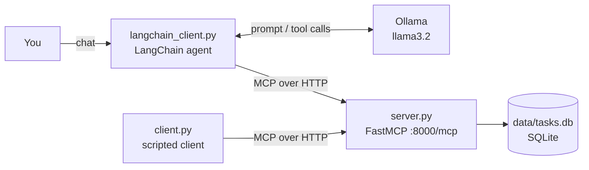

# LLM_MCP

A small **task-management MCP server** built with [FastMCP](https://gofastmcp.com), backed by SQLite, plus two clients:

- **`client.py`**: a scripted client that calls the server's tools directly.
- **`langchain_client.py`**: an interactive chat agent. A local LLM (Llama 3.2 via [Ollama](https://ollama.com)) decides which MCP tools to call based on what you type.

The project is a hands-on example of the [Model Context Protocol](https://modelcontextprotocol.io): expose tools from a server, then let a program or an LLM discover and call them over HTTP.

---

## Table of contents

- [How it works](#how-it-works)
- [Project structure](#project-structure)
- [Prerequisites](#prerequisites)
- [Installation](#installation)
- [Usage](#usage)
  - [1. Initialize the database](#1-initialize-the-database)
  - [2. Start the MCP server](#2-start-the-mcp-server)
  - [3a. Run the scripted client](#3a-run-the-scripted-client)
  - [3b. Chat with the LLM agent](#3b-chat-with-the-llm-agent)
  - [Use the server from other MCP clients](#use-the-server-from-other-mcp-clients)
- [Tools reference](#tools-reference)
- [Data model](#data-model)
- [Configuration](#configuration)
- [Troubleshooting](#troubleshooting)
- [Known limitations](#known-limitations)

---

## How it works



1. `server.py` registers three tools (`create_task`, `list_tasks`, `update_task_status`) and serves them over streamable HTTP at `http://127.0.0.1:8000/mcp`.
2. Each tool reads from or writes to a SQLite database at `data/tasks.db` through `database.py`.
3. A client connects to the endpoint, lists the available tools, and calls them:
   - `client.py` calls them with hard-coded arguments.
   - `langchain_client.py` passes the tool definitions to an LLM. The LLM chooses the tool and fills in the arguments from your message. The agent prints the tools it called so you can see what happened.

---

## Project structure

```
llm_mcp/
├── data/                      # created at runtime, git-ignored
│   └── tasks.db               # SQLite database
├── src/
│   └── mcp_server/
│       ├── __init__.py
│       ├── server.py          # FastMCP server and tool definitions
│       ├── database.py        # SQLite schema and queries (+ self-check)
│       ├── client.py          # scripted FastMCP client
│       └── langchain_client.py# interactive LLM agent (Ollama + LangChain)
├── requirements.txt
└── README.md
```

---

## Prerequisites

| Requirement | Needed for | Notes |
|---|---|---|
| Python **3.12+** | everything | Developed on 3.12.1 |
| [Ollama](https://ollama.com/download) | `langchain_client.py` only | Must be running locally |
| `llama3.2` model | `langchain_client.py` only | `ollama pull llama3.2` |

---

## Installation

```bash
git clone <your-repo-url> llm_mcp
cd llm_mcp

python3 -m venv .venv
source .venv/bin/activate        # Windows: .venv\Scripts\activate

pip install -r requirements.txt
```

For the LLM agent, also install the model:

```bash
ollama pull llama3.2
```

> **Run all commands from the project root.** The modules import each other as `src.mcp_server...`, so start them with `python -m src.mcp_server.<module>`, not `python src/mcp_server/<module>.py`.

---

## Usage

### 1. Initialize the database

The server does **not** create the database table on startup, and `data/` is git-ignored. Run this once on a fresh clone:

```bash
python -c "from src.mcp_server.database import init_db; init_db()"
```

This creates `data/tasks.db` with an empty `tasks` table. It is safe to run again (`CREATE TABLE IF NOT EXISTS`).

You can also run the database self-check, which initializes the DB and then tests insert, update, missing ID, and the invalid-status constraint:

```bash
python -m src.mcp_server.database
# -> ok
```

> The self-check inserts a task titled `demo` into the real database.

### 2. Start the MCP server

```bash
python -m src.mcp_server.server
```

The server listens on **`http://127.0.0.1:8000/mcp`**. Leave it running in its own terminal.

### 3a. Run the scripted client

In a second terminal (with the venv activated):

```bash
python -m src.mcp_server.client
```

This runs the following steps in order:

1. Prints the names of the available tools.
2. Lists all tasks.
3. Creates a task: *"Record MCP Tutorial"* (priority `high`).
4. Lists all tasks again.
5. Updates a task's status to `IN-PROGRESS`.
6. Lists all tasks again.

> Step 5 uses a **hard-coded `task_id`** in `update_task_status_from_mcp()`. On your database that ID won't exist, so the call returns `{"error": "the task_id ... does not exist"}`. Copy a real `task_id` from the step 4 output into `client.py` to see a successful update.

### 3b. Chat with the LLM agent

Make sure Ollama is running (`ollama serve`, or the desktop app) and the server from step 2 is up. Then run:

```bash
python -m src.mcp_server.langchain_client
```

The agent opens with *"can you please help me"*, then prompts you for input. Type requests in plain English, and type `q` to quit.

Example session:

```
please ask your question or type q to exit:
add a high priority task to buy groceries
Tool called: create_task
Arguments: {'title': 'buy groceries', 'priority': 'high'}
I've created the task "buy groceries" with high priority.

please ask your question or type q to exit:
what tasks do I have?
Tool called: list_tasks
Arguments: {}
...

please ask your question or type q to exit:
mark buy groceries as done
Tool called: list_tasks
Tool called: update_task_status
Arguments: {'task_id': '3f2c...', 'status': 'DONE'}
...
```

(The LLM's exact wording and tool choices vary between runs.)

Conversation memory lasts for the session: the agent uses LangGraph's `InMemorySaver` with one `thread_id` per run, so it remembers earlier messages until you quit. Tool-call details are printed after each reply. The printout covers every message in the thread, so tool calls from earlier turns appear again.

### Use the server from other MCP clients

Any client that supports streamable HTTP can connect to `http://127.0.0.1:8000/mcp`. For example:

- **MCP Inspector** (browse and call tools in a web UI):
  ```bash
  npx @modelcontextprotocol/inspector
  ```
  Choose transport **Streamable HTTP** and enter the URL above.
- **Claude Code**:
  ```bash
  claude mcp add --transport http tasks http://127.0.0.1:8000/mcp
  ```

---

## Tools reference

### `create_task`

Creates a new task with status `TO-DO`.

| Parameter | Type | Required | Default |
|---|---|---|---|
| `title` | `str` | yes | — |
| `priority` | `str` | no | `"medium"` |
| `description` | `str` | no | `""` |

**Returns** the created task:

```json
{
  "task_id": "9a4a29bc-7b88-458c-b71c-cde3bd8d4b10",
  "title": "Record MCP Tutorial",
  "description": "Create a YouTube tutorial about MCP",
  "status": "TO-DO",
  "priority": "high"
}
```

`priority` is free text and is not validated. `low` / `medium` / `high` is the intended convention.

### `list_tasks`

Returns every task in the database as a list of task objects (same shape as above). Takes no parameters.

### `update_task_status`

Changes the status of one task.

| Parameter | Type | Required | Allowed values |
|---|---|---|---|
| `task_id` | `str` | yes | an existing task's UUID |
| `status` | `str` | yes | `TO-DO`, `IN-PROGRESS`, `DONE` |

**Returns** the updated task, or an error object if the ID doesn't exist:

```json
{ "error": "the task_id 1234 does not exist" }
```

An invalid status is rejected twice: FastMCP validates the argument against the `Status` literal type before the tool runs, and the database has a `CHECK` constraint as a backstop.

---

## Data model

`data/tasks.db` has a single table:

```sql
CREATE TABLE tasks (
    task_id     TEXT PRIMARY KEY,               -- UUID4 string
    title       TEXT NOT NULL,
    description TEXT NOT NULL,
    priority    TEXT NOT NULL DEFAULT 'medium',
    status      TEXT NOT NULL DEFAULT 'TO-DO'
        CHECK (status IN ('TO-DO', 'IN-PROGRESS', 'DONE'))
);
```

To inspect the data directly:

```bash
sqlite3 data/tasks.db "SELECT task_id, title, priority, status FROM tasks;"
```

To start over, delete `data/tasks.db` and run [step 1](#1-initialize-the-database) again.

---

## Configuration

There are no config files or environment variables yet. Settings are hard-coded in the source:

| Setting | Where | Value |
|---|---|---|
| Server port | `server.py` (`mcp.run`) | `8000` |
| Server URL used by clients | `client.py`, `langchain_client.py` | `http://127.0.0.1:8000/mcp` |
| Database path | `database.py` (`db_path`) | `<project root>/data/tasks.db` |
| LLM model | `langchain_client.py` (`ChatOllama`) | `llama3.2:latest` |
| Agent system prompt | `langchain_client.py` | `"you are a helpful task management assistant"` |

To use a different Ollama model, change the `model=` argument. The model must support **tool calling**, for example `llama3.1`, `llama3.2`, `qwen2.5`, or `mistral`.

`langchain-openai` and `dotenv` are in `requirements.txt` but aren't used yet. They're there in case you want to switch the agent to an OpenAI model (`ChatOpenAI`) with an API key loaded from a `.env` file. `.env` is already git-ignored.

---

## Troubleshooting

| Symptom | Cause | Fix |
|---|---|---|
| `sqlite3.OperationalError: no such table: tasks` | Database not initialized | Run [step 1](#1-initialize-the-database) |
| `ModuleNotFoundError: No module named 'src'` | Script run by file path, or from the wrong directory | `cd` to the project root and use `python -m src.mcp_server.<module>` |
| Client fails with connection refused | Server not running | Start it with `python -m src.mcp_server.server` |
| `OSError: [Errno 98] Address already in use` | Port 8000 is taken | Stop the other process, or change the port in `server.py` **and** both clients |
| Agent errors connecting to Ollama | Ollama not running | Start `ollama serve` or the Ollama app |
| `model "llama3.2:latest" not found` | Model not downloaded | `ollama pull llama3.2` |
| Agent answers without calling any tool | Small models sometimes skip tools | Ask more explicitly ("use the list_tasks tool"), or try a larger model |
| `update_task_status` returns `"does not exist"` from `client.py` | Hard-coded `task_id` | Paste a real `task_id` into `client.py` |

---

## Known limitations

- There are no `delete_task` or `edit_task` tools. Only status can change after a task is created.
- `priority` isn't validated, so any string is accepted.
- The server binds to localhost and has no authentication. Don't expose it to a network as-is.
- Each database call opens a new SQLite connection. That's fine for a single user, but not built for concurrent load.
- Agent memory is in-process only and is lost when `langchain_client.py` exits. Tasks themselves are stored in SQLite and persist between runs.
